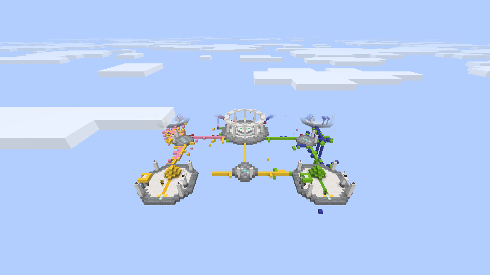
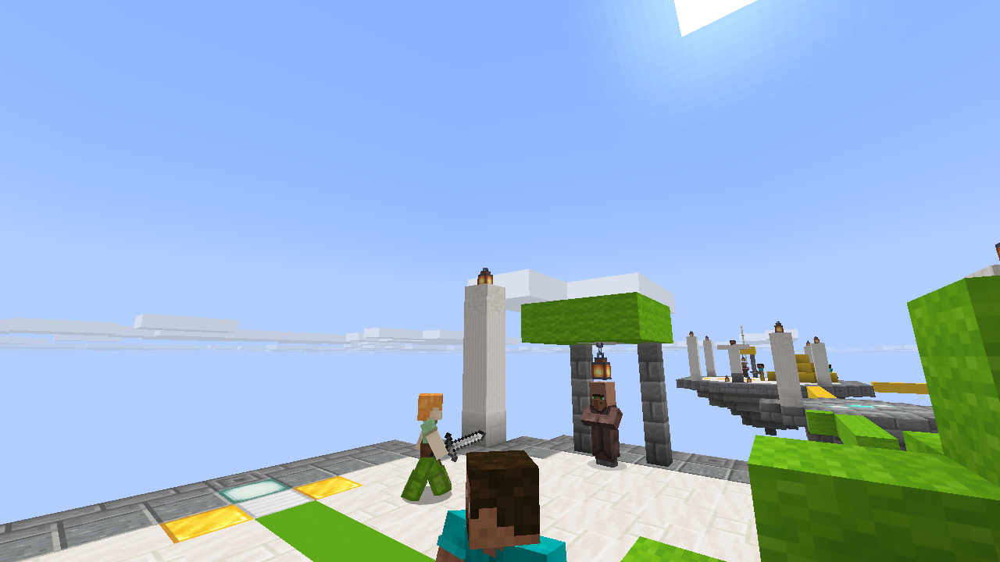
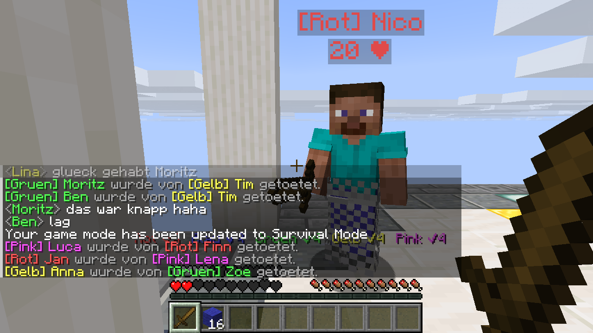
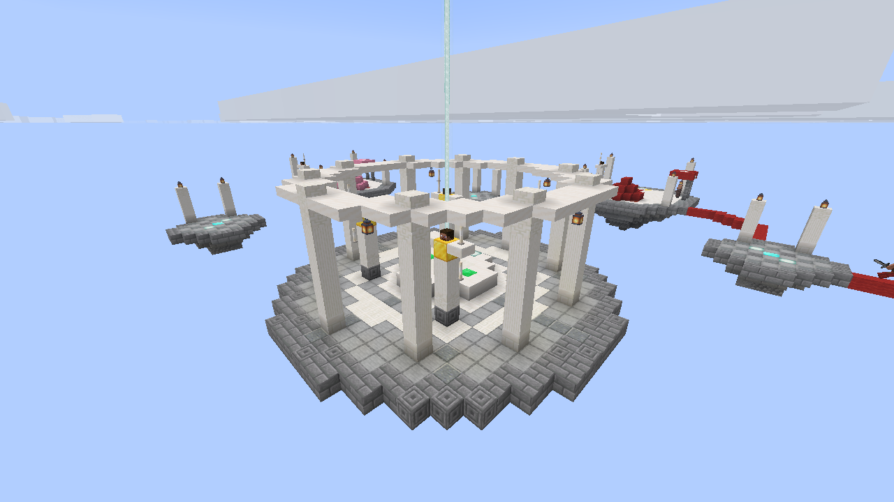
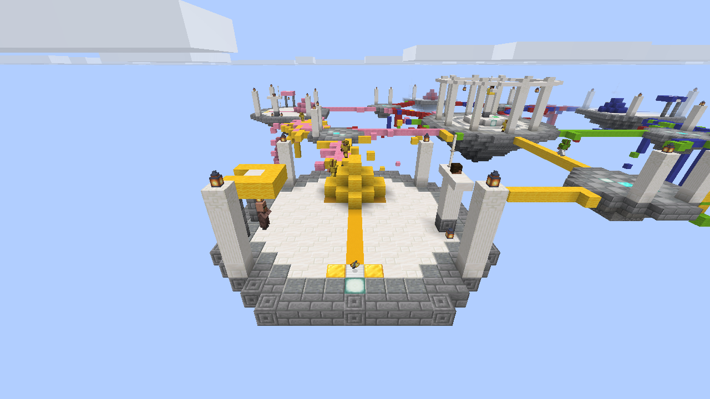

# GlowCube Bedwars 2.0 – Fabric-Mod für Minecraft 26.3

Beim Betreten einer Einzelspielerwelt startet sofort eine Bedwars-Runde: fünf Teams,
du bist mit drei Bots in einem davon, die anderen vier Teams sind komplett Bots.

Das fertige JAR liegt unter `dist/glowcube-bedwars-2.0.0.jar`
(braucht Fabric Loader ≥ 0.17 und die Fabric API für 26.3).



## Was neu ist gegenüber 1.0

### Bots sehen aus wie Spieler

Statt Wüstenzombies sind die Bots jetzt echte Spielermodelle (das Mannequin von 26.x)
mit **Steve- oder Alex-Skin** – Mädchennamen bekommen Alex, Jungennamen Steve.
Damit man die Skins auch sieht, tragen Bots nur Teamhose und Teamschuhe; den fehlenden
Schutz von Helm und Brustpanzer bekommen sie unsichtbar dazu. Über dem Kopf steht
`[Team] Name`, darunter die Lebenspunkte.



### Die KI

Jeder Bot hat einen Charakter (Stürmer, Bauer, Sammler, Kämpfer) mit eigenen Werten
für Aggressivität, Können, Vorsicht, Gesprächigkeit und Frechheit.

**Bewegen und Bauen** – eine A*-Wegsuche über das Blockraster kennt Laufen, Springen,
Fallen, **Brücken bauen**, **Hochbauen** und **Blöcke abbauen**, jeweils mit Kosten.
Vorhandene Brücken werden bevorzugt, neue werden gerade und gezielt gebaut statt zufällig.
Steht ein Block im Weg, wird gesprungen, abgebaut oder neu geplant – nie mehr endlos
dagegenlaufen. Wer von einer Kante gestoßen wird, setzt (je nach Können) einen
**Clutch-Block** unter sich.

**Kämpfen** – Strafen, Krit-Sprünge, W-Tap mit Rückstoß, Zielen nach Reichweite,
Rückzug mit Goldapfel bei wenig Leben, Feuerbälle auf Gegner aus der Ferne. Bots laufen
nicht blind in die Leere, sondern prüfen den Boden vor jedem Schritt.

**Team-Strategie** – jedes Team hat einen Strategen, der alle zwei Sekunden (und sofort
bei Alarm) die Aufträge verteilt:

* einer baut das Bett zu: Wolle innen, Endstein, dann Holz – Schicht für Schicht,
  und Löcher werden nachgebaut
* einer verteidigt, Eindringlinge auf der Insel lösen sofort Alarm aus – **wer auf ihre
  Insel geht, wird angegriffen**, die ganze Truppe kommt zurück
* baut jemand eine Brücke zur Insel, **reißt ein Bot sie ab**
* Mitte: Diamanten und Smaragde holen, Diamanten gehen in Team-Upgrades
  (Eisenschmiede, Geschärfte Klingen, Schutz I–III, Heilfeld)
* Angriffe zu zweit (Stürmer + Begleitschutz) auf das lohnendste Ziel: Nachbarn,
  schwach verteidigte Betten, Teams mit wenig Leuten – und Teams mit Rechnung offen
* manchmal **jagen sie dich** – öfter, wenn du ihr Bett geholt oder sie oft getötet hast
* **ohne Bett spielen sie vorsichtig**: wer weit weg und schlecht ausgerüstet ist, kommt
  heim, erst wird eingekauft, dann geht es nur gemeinsam und nur gegen Schwächere los

**Chat-KI** – die Bots schreiben in den Chat: Begrüßung, Reaktionen auf Betten,
Kills, Clutches, Käufe, Absprachen im Team (`[TEAM]`). Sie verstehen auch dich:

| Du schreibst | Deine Teamkollegen … |
| --- | --- |
| `verteidigt`, `bleibt beim bett` | bleiben am Bett |
| `greift blau an`, `rush gelb` | greifen dieses Team an |
| `folgt mir`, `kommt mit` | laufen hinter dir her |
| `hilfe`, `komm schnell` | kommen zu dir |
| `holt dias`, `mitte` | gehen Diamanten/Smaragde holen |
| `baut das bett zu` | bauen die Verteidigung neu |
| `wo seid ihr` | sagen, wo sie sind |
| `wie viel eisen habt ihr` | nennen den Team-Vorrat |
| `stop`, `normal` | machen wieder ihr eigenes Ding |

Auf `hallo`, `gg`, `noob`, `bist du ein bot?` und Ähnliches antworten auch die Gegner.



### Die Karte

* **Römische Team-Inseln**: Quarzboden mit Teamweg, Säulen mit Laternen, Statue mit
  leuchtendem Speer, Shop-Pavillon, Generator aus Eisen- und Goldblöcken, darunter
  ein schwebender Felsen. **Das Bett steht von Anfang an** – nie mehr im Inventar.
* **Die Mitte**: ein runder Tempel aus zehn Säulen, in der Mitte ein **Leuchtfeuer**,
  dessen Strahl durch die offene Kuppel in den Himmel geht, vier goldene Wächterstatuen
  und die Smaragd-Spawner.
* **Fünf Diamant-Inseln** zwischen den Team-Inseln.




### Spielablauf

* mehr Eisen als vorher, Diamant- und Smaragd-Spawner werden nach 6/9/12/15 Minuten schneller
* Shop mit Wolle, Endstein, Holz, Schere, Spitzhacken, Schwertern, Feuerbällen,
  Goldäpfeln, Enderperlen, Rüstung und den Team-Upgrades
* nach 12 Minuten fallen alle Betten, ab 15 Minuten **Sudden Death** (alle Bots leuchten
  und greifen an) – jede Runde findet ein Ende
* während der Runde ist immer Mittag, danach läuft die Weltuhr dort weiter, wo sie war
* der Schwierigkeitsgrad steht während der Runde auf „Normal“ (sonst machen die Bots
  auf „Friedlich“ keinen Schaden) und wird danach zurückgesetzt
* am Ende: Siegerteam und bester Bot mit Kills, Finals und Betten

## Befehle

| Befehl | Wirkung |
| --- | --- |
| `/bedwars start` | neue Runde |
| `/bedwars stop` | Runde beenden, Inventar zurück |
| `/bedwars status` | Teams, Betten und was jeder Bot gerade macht |
| `/bedwars shop` | Shop öffnen |
| `/bedwars auto an\|aus` | Autostart beim Betreten |
| `/bedwars test` | Runde mit einem Platzhalter-Spieler und Protokoll in der Konsole |
| `/bedwars say <text>` | Chat-KI testen, als hätte man es geschrieben |

## Aufbau

| Datei | Inhalt |
| --- | --- |
| `BedwarsMod` | Einstieg, Ereignisse, Befehle |
| `Game` | Runde, Teams, Betten, Kills, Spawner, Upgrades, Endspiel |
| `Arena` | die Karte |
| `BedwarsBot` | der Bot-Körper: Steuerung, Wege, Kampf, Bauen, Abbauen |
| `Pathfinder` | A*-Wegsuche mit Brücken, Hochbauen und Abbauen |
| `TeamBrain` | der Stratege jedes Teams |
| `BotProfile` | Charakter, Inventar, Einkauf, Auftrag |
| `BotChat` | die Chat-KI |
| `Shop`, `BwTeam` | Shop und Teamfarben |

`lib/glowcube-bedwars-1.0.0.jar` ist die alte Fassung, nur zum Vergleich.

## Bauen

```bash
./build.sh          # -> dist/glowcube-bedwars-2.0.0.jar
```

Voraussetzungen: JDK 25 oder neuer, `curl`, `unzip`, `zip`.

Seit 26.x liefert Mojang das Spiel unverschleiert aus. Eine Mod ohne Mixins lässt sich
deshalb direkt mit `javac` gegen das Client-JAR, seine Bibliotheken, den Fabric Loader
und die Fabric API übersetzen – ohne Gradle und Loom. Das Skript lädt diese einmalig
nach `.build/`.
