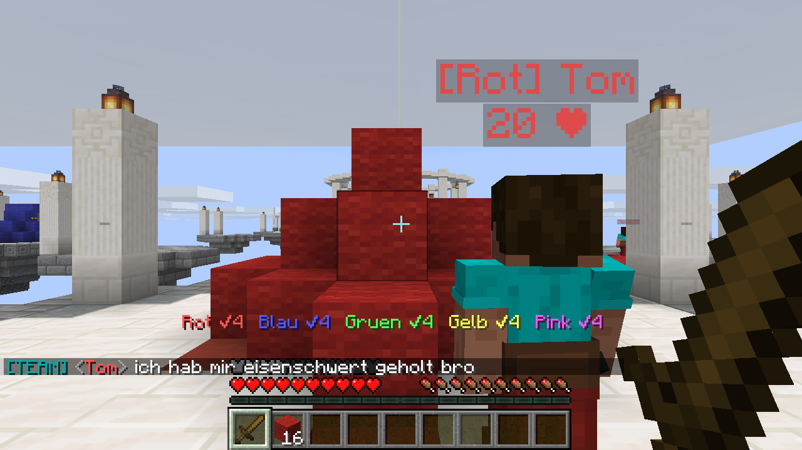
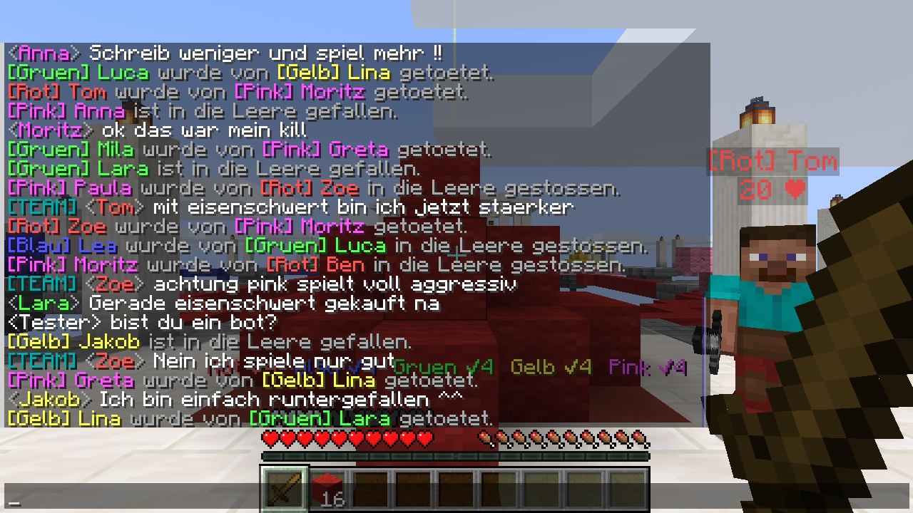

# GlowCube Bedwars 3.1 – Fabric-Mod für Minecraft 26.3

Fünf Teams mit je vier Spielern; alle Plätze, die keine echten Spieler haben, füllen Bots.
Beim Betreten der Welt startet nichts von selbst: Im Chat erscheinen die Knöpfe
**[▶ ALLEIN MIT BOTS]** und **[MULTIPLAYER]** (oder `/bedwars start`).

Das fertige JAR liegt unter `dist/glowcube-bedwars-3.1.0.jar`
(braucht Fabric Loader ≥ 0.17 und die Fabric API für 26.3).


## Neu in 3.1: Multiplayer (z.B. mit Essential)

Teile deine Welt mit Essential (oder über LAN / einen Server). Die Mod braucht nur der
Host: Die Bots sind normale Minecraft-Figuren, Freunde können auch ohne die Mod beitreten.

1. Jemand schreibt **`bedwars 2`** oder **`bedwars multiplayer`** in den Chat
   (auch „bad wars 2“, „bedwars zu zweit“, `/bedwars multiplayer`).
2. Alle anderen auf dem Server bekommen eine Einladung mit Titel-Einblendung, Ton und den Knöpfen
   **[✔ JA, ICH SPIEL MIT]** / **[✖ NEIN]**. Man kann auch einfach „ja“ oder „nein“ schreiben.
3. Wer eingeladen hat, sieht **[▶ JETZT STARTEN]** und **[✖ ABBRECHEN]**. Sobald alle geantwortet haben (spätestens nach 30 Sekunden), geht es los.

**Gleich viele Spieler:** Jeder echte Spieler ersetzt einen Bot. Es bleiben immer
5 Teams mit je 4. Zu zweit zusammen heißt also: ihr zwei und zwei Bots in einem Team.

* **Immer zusammen:** Alle echten Spieler sind in einem Team, dazu kommen 4 Bot-Teams, die
  gegen euch und gegeneinander kämpfen (ab 5 echten Spielern kommt der Rest ins nächste Team).
* **Teamchat:** Mit `@` vor der Nachricht lesen nur dein Team und deine Bots mit
  (`@ verteidigt das bett`). Befehle an die Bots funktionieren für jeden echten Spieler im Team.
* Die Bots reden über die echten Spieler: Sie begrüßen ihre echten Teamkollegen,
  kommentieren Kämpfe zwischen echten Spielern und loben Kills im Team.
* Am Ende kommen eine Rangliste aller echten Spieler (Kills, Finals, Betten, Tode) und der
  Knopf **[↻ REVANCHE]**.
* Wer die Runde verlässt, scheidet aus. Kommt er zurück, schaut er zu. Inventar und Position
  bekommt jeder am Ende zurück (wer offline ist, beim nächsten Betreten).
* Wer nicht mitspielt, kann Bots und Mitspielern keinen Schaden machen und die Arena nicht abbauen.

## Neu in 3.0: die Bots spielen wie Menschen

### Kämpfen wie ein Mensch statt Kill-Aura

Jeder Bot bekommt einen **Spielertyp** – Anfänger, Gelegenheitsspieler, solide oder
Schwitzer – und damit eigene „Hände":

* **Reaktionszeit**: Bots sehen Bewegungen erst 150–650 ms später, je nach Typ.
* **Echtes Zielen**: Ein Fadenkreuz dreht sich mit begrenzter Geschwindigkeit zum Ziel,
  zittert, zieht nach und schießt beim schnellen Umdrehen über. **Getroffen wird nur,
  wenn der Strahl aus dem Auge die Hitbox trifft** – strafed man, schlagen sie daneben.
* **Klick-Rhythmus**: Disziplinierte Spieler warten die Schlag-Abklingzeit ab, andere
  spammen – dann richten die Schläge wie bei Spielern nur einen Bruchteil des Schadens an
  (Schadensformel aus 1.9+). Anfänger schlagen auch schon aus zu großer Entfernung ins Leere.
* **Fehler**: kurze Aussetzer mitten im Kampf, nicht strafen, an der Kante nicht aufpassen
  und runterfallen, beim Brücken einen Block verpassen, den Goldapfel vergessen. Wer
  mehrmals kurz hintereinander stirbt, wird **genervt (Tilt)** und spielt schlechter.
* In einem Testspiel trafen solide Bots etwa 36–44 % ihrer Schläge, Gelegenheitsspieler
  7–43 %, Anfänger um 8 %.

Mit `/bedwars schwierigkeit leicht|normal|schwer|profi` verschiebt sich die Mischung der
Spielertypen (leicht: fast nur Anfänger und Gelegenheitsspieler, profi: fast nur Schwitzer).

### Eine echte kleine KI für die Strategie

Was jeder Bot gerade macht – sammeln, einkaufen, Bett zubauen, verteidigen, angreifen,
Mitte, jagen, begleiten, sammeln – entscheidet jetzt ein **kleines neuronales Netz**
(36 Eingänge → 24 Neuronen → 9 Bewertungen). Es sieht die Lage aus Sicht des Bots:
Bett, Leben, Ausrüstung, Blöcke, Team-Ressourcen, Gegner auf der Insel oder auf dem Weg,
wie gut das eigene Bett geschützt ist, was die Teamkollegen schon machen, das lohnendste
Angriffsziel, ob der Spieler in der Nähe ist, und wie die Gegner spielen.

**Gegner-Modell**: Jedes Team beobachtet die anderen und erkennt ihre Strategie –
*Rusher* (kommen ständig rüber), *Bunker* (bauen sich ein), *Wirtschaft* (campen die Mitte).
Das fließt ins Netz ein, und die Bots sagen es im Team-Chat („gelb rusht dauernd, wir
müssen mehr verteidigen").

**So wurde das Netz trainiert** (Skript: `tools/train_brain.py`, alles auf einem Testserver im Zeitraffer):

1. 30 Runden mit dem alten Regelwerk, dabei jede Entscheidung aufgezeichnet (24 487 Beispiele).
2. Das Netz hat diese Entscheidungen nachgelernt – 79 % Übereinstimmung auf Daten, die es
   beim Lernen nicht gesehen hat.
3. Feinabstimmung gegen das Regelwerk: in jeder Runde zwei Netz-Teams gegen drei Regel-Teams,
   15 Generationen Evolutionsstrategie auf den Neigungen des Netzes (wie gern es angreift,
   verteidigt, sammelt, jagt …).

**Ehrliches Ergebnis** aus je 30 Vergleichsrunden: Das Netz spielt **so stark wie das
handgeschriebene Regelwerk**, aber nicht stärker (mittlere Platzierung 3,04 gegen 2,96;
es holt etwas weniger Betten, 0,56 gegen 0,77 pro Team und Runde). Ein erster Versuch mit
30 Generationen reinem Selbstspiel über alle Gewichte hat nichts gebracht – das so
trainierte Netz war schwächer und ist nicht eingebaut. Der Vorteil des Netzes: Es
entscheidet weicher und abwechslungsreicher als feste Regeln, und es lässt sich mit dem
Skript weiter trainieren.

Reflexe bleiben fest eingebaut: Eindringlinge auf der Insel werden angegriffen (aber nicht
alle bemerken es sofort, und meist bleibt einer bei seiner Aufgabe), Brücken zur Insel
werden abgerissen, Teamkollegen helfen, wenn einer angegriffen wird.

### Teamkollegen kaufen aktiv ein

Wer zu Hause ist und sich etwas Sinnvolles leisten kann, geht zum Shop: Schwerter,
Rüstung, Wolle, Endstein, Schere, Spitzhacke, Goldäpfel, Feuerbälle. Deine Teamkollegen
erzählen im Team-Chat, was sie sich geholt haben. Mit „kauft euch was" schickst du alle
zum Shop.



### Hochbauen

Bots bauen sich hoch: als Teil der Wegsuche (über Hindernisse, zurück auf eine Insel),
um an einen Gegner über ihnen heranzukommen und – solide Spieler und Schwitzer – in Not,
um einem verlorenen Nahkampf zu entkommen. In einem 12-Minuten-Testspiel wurden 61 Blöcke
zum Hochbauen gesetzt, dazu 39 Clutch-Blöcke.

### Der Chat schreibt sich selbst

Die Bots ziehen keine fertigen Sätze mehr aus einer Liste. Ein **Sprachmodell**
(Wort-Trigramme pro Situation, gelernt aus `resources/.../chat/corpus.txt`) bildet neue
Sätze, bewertet mehrere Kandidaten nach Flüssigkeit und Neuheit und vermeidet, was gerade
erst jemand geschrieben hat. Beispiele aus einem Testspiel: „die leere hat mich geschubst",
„zu einfach das bett war zu schwach blau", „jetzt kommt es drauf an".

Jeder Bot hat seinen **eigenen Schreibstil**: klein oder groß, Slang („digga", „alter",
„bro"), Abkürzungen („nich", „hab", „nen"), Smileys, gelegentliches Schreien in
Großbuchstaben und Tippfehler – Anfänger vertippen sich öfter.

**Verstehen**: Ein **Naive-Bayes-Klassifikator**, trainiert auf Beispielsätzen
(`chat/intents.txt`), erkennt, was du meinst – Befehl, Frage, Gruß, Beleidigung, Lob,
„bist du ein bot?" … – und wie sicher er sich ist. Ist er unsicher, helfen Schlüsselwörter.

| Du schreibst (zum Beispiel) | Deine Teamkollegen … |
| --- | --- |
| „verteidigt mal unser bett" | bleiben am Bett |
| „greift blau an", „lasst uns gelb rushen" | greifen dieses Team an |
| „kommt mit", „folgt mir mal" | laufen hinter dir her |
| „hilfe", „kommt schnell her" | kommen zu dir |
| „holt dias", „wir brauchen smaragde" | gehen in die Mitte |
| „baut das bett zu" | bauen die Verteidigung neu |
| „kauft euch was", „holt euch rüstung" | gehen einkaufen |
| „was ist der plan" | erklären, was das Team vorhat |
| „wo seid ihr" / „wie viel eisen habt ihr" | sagen, wo sie sind / was das Team hat |
| „stop", „macht was ihr wollt" | machen wieder ihr eigenes Ding |

Auf Gruß, „gg", Lob, Beleidigungen, „bist du ein bot?" oder „wie gehts" antworten auch
die Gegner. Zwischendurch reden die Bots von sich aus („wer campt mitte", „ich spare auf
diamantruestung").



## Weiterhin dabei (aus 2.0)

* **Spielermodelle mit Steve- oder Alex-Skin**, `[Team] Name` und Lebensanzeige über dem Kopf.
  Bots tragen nur Teamhose und -schuhe, damit man die Skins sieht.
* **A*-Wegsuche** mit Laufen, Springen, Fallen, Brückenbau, Hochbauen und Abbauen.
* Bett in Schichten zubauen (Wolle, Endstein, Holz), Brücken der Gegner abreissen,
  Mitte und Team-Upgrades (Eisenschmiede, Geschärfte Klingen, Schutz I–III, Heilfeld).
* Ohne Bett spielen Teams vorsichtig: erst ausrüsten, dann nur gemeinsam.
* **Römische Karte**: Inseln mit Säulen und Statuen, Rundtempel mit Leuchtfeuer in der
  Mitte, fünf Diamant-Inseln. Das Bett steht von Anfang an.
* Nach 12 Minuten fallen alle Betten, ab 15 Minuten Sudden Death. Während der Runde ist
  Mittag und der Schwierigkeitsgrad „Normal"; beides wird danach zurückgesetzt.


## Befehle

| Befehl | Wirkung |
| --- | --- |
| `/bedwars start` | neue Runde allein mit Bots |
| `/bedwars multiplayer` | alle auf dem Server einladen (wie „bedwars 2“ im Chat) |
| `/bedwars ja` / `nein` | Einladung annehmen / ablehnen |
| `/bedwars los` / `abbrechen` | (wer eingeladen hat) sofort starten / abbrechen |
| `/bedwars stop` | Runde beenden, Inventar zurück |
| `/bedwars status` | Teams, Betten, Spielertyp, Trefferquote und Auftrag jedes Bots |
| `/bedwars schwierigkeit <stufe>` | leicht, normal, schwer oder profi (ab der nächsten Runde) |
| `/bedwars shop` | Shop öffnen |
| `/bedwars auto an\|aus` | Autostart beim Betreten (Standard: aus) |
| `/bedwars test` | reine Bot-Runde mit Protokoll in der Konsole |
| `/bedwars say <text>` | Chat-KI testen, als hätte man es geschrieben |
| `/bedwars train <ordner>` / `record <ordner>` | fürs Training: Runde mit Netzen aus `teams.json` bzw. mit Aufzeichnung |

Die Schwierigkeit steht in `config/glowcube_bedwars.properties`.

## Aufbau

| Datei | Inhalt |
| --- | --- |
| `BedwarsMod` | Einstieg, Ereignisse, Befehle |
| `Game` | Runde, Teams, Betten, Kills, Spawner, Upgrades, Endspiel, Training |
| `Arena` | die Karte |
| `BedwarsBot` | der Bot-Körper: Steuerung, Wege, Zielen, Kampf, Bauen, Hochbauen |
| `Hands` | Spielertyp: Reaktion, Zielen, Klicks, Fehlerquoten |
| `Pathfinder` | A*-Wegsuche mit Brücken, Hochbauen und Abbauen |
| `TeamBrain` | Stratege: Reflexe, Gegner-Modell, Planung mit dem Netz, Befehle |
| `StrategyNet` | das neuronale Netz (Gewichte in `resources/.../brain.json`) |
| `BotProfile` | Charakter, Inventar, Einkauf, Auftrag |
| `ChatBrain` | Sprachmodell, Schreibstil, Absicht-Klassifikator |
| `BotChat` | wann wer was schreibt, Spieler verstehen |
| `Shop`, `BwTeam`, `Config` | Shop, Teamfarben, Einstellungen |

## Bauen

```bash
./build.sh          # -> dist/glowcube-bedwars-3.1.0.jar
```

Voraussetzungen: JDK 25 oder neuer, `curl`, `unzip`, `zip`.

Seit 26.x liefert Mojang das Spiel unverschleiert aus. Eine Mod ohne Mixins lässt sich
deshalb direkt mit `javac` gegen das Client-JAR, seine Bibliotheken, den Fabric Loader
und die Fabric API übersetzen – ohne Gradle und Loom. Das Skript lädt diese einmalig
nach `.build/`.

Das Netz neu trainieren (braucht Python 3 mit numpy und einen Fabric-Server mit der Mod,
dessen Konsole an einer FIFO hängt):

```bash
python3 tools/train_brain.py teacher --console server/console.in --work /tmp/bw --games 30
python3 tools/train_brain.py clone   --console server/console.in --work /tmp/bw
python3 tools/train_brain.py evolve  --console server/console.in --work /tmp/bw \
    --bias-only --vs-rules --out brain_tuned.json --generations 15 --sigma 0.3 --lr 0.4 --pairs 4
python3 tools/train_brain.py eval    --console server/console.in --work /tmp/bw --games 30 --candidate brain_tuned.json
cp /tmp/bw/brain_tuned.json resources/assets/glowcube_bedwars/brain.json
```
